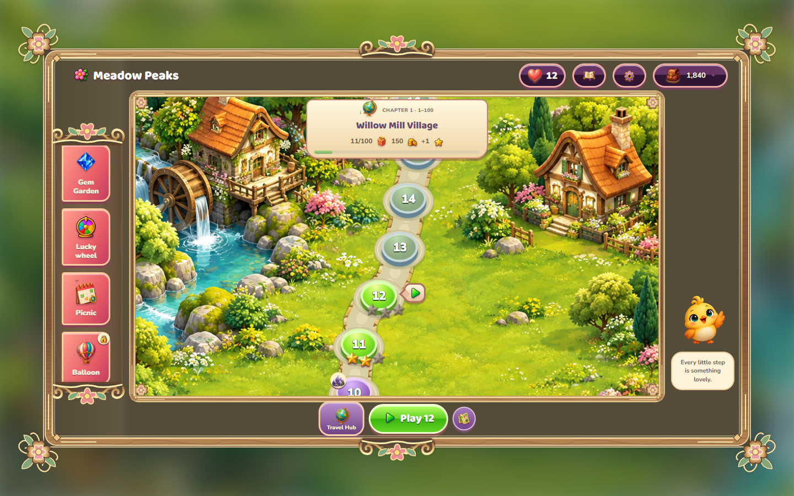
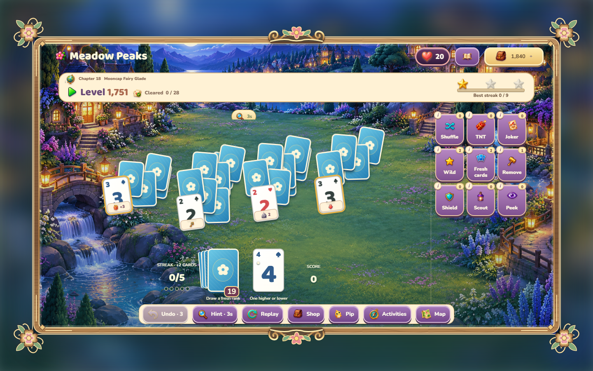
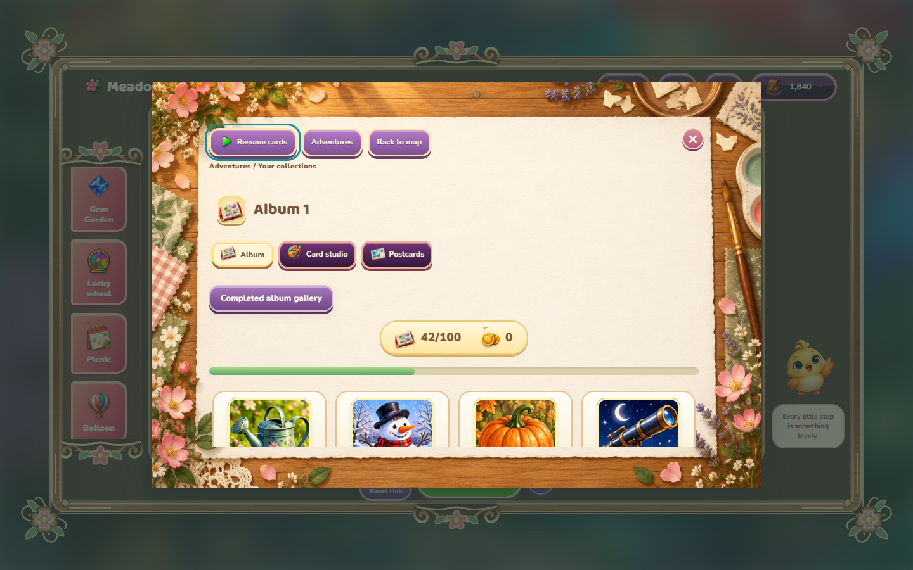
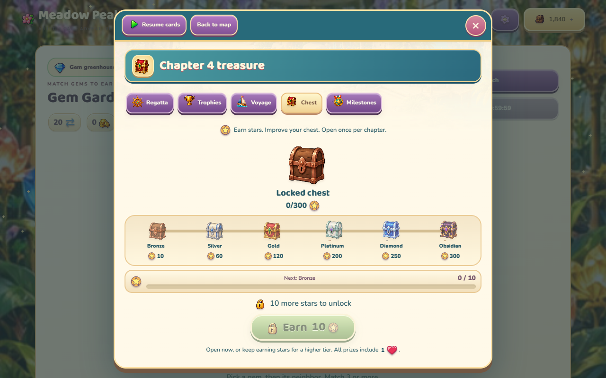
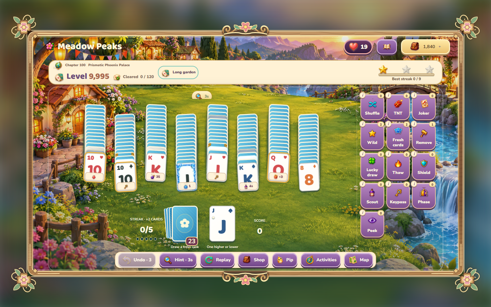
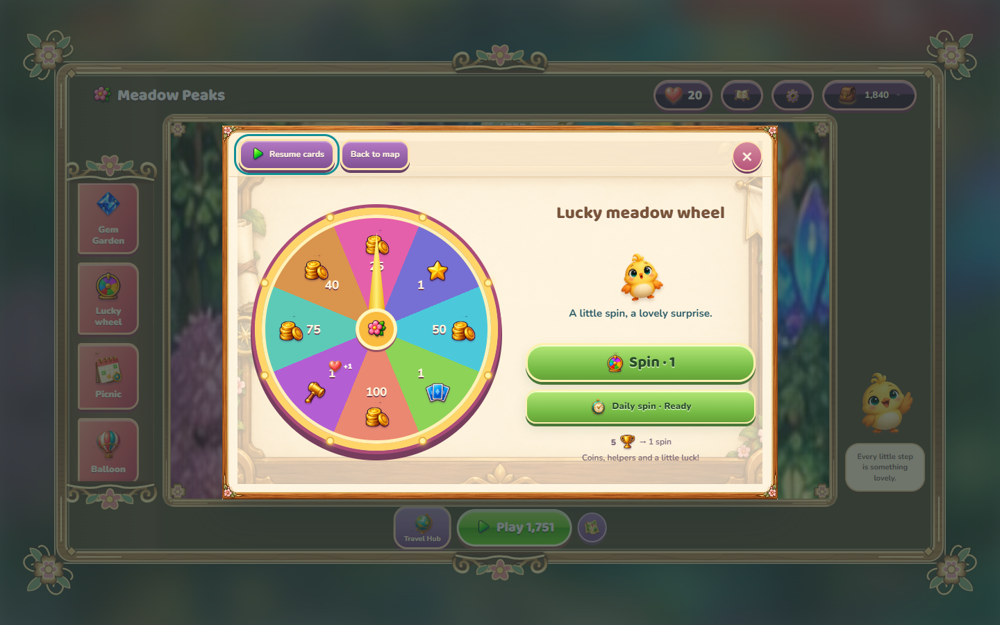

# Meadow Peaks

A colorful TriPeaks adventure for **Windows and the browser**. Follow Pip through
480,000 campaign levels, collect chapter designs, and earn helpers through connected
side games. Both platforms run the same game code and original artwork. Pip shares rotating
solitaire thoughts on the home screen; tap him for another.



## Play

Development builds require the **.NET 10 LTS SDK**. The Windows app, core, tests
and CI target .NET 10; portable releases continue to bundle their runtime.

The typed C# [interface catalog](src/MeadowPeaks.Core/Content/InterfaceCatalog.cs)
owns feature definitions, unlock levels, activity groups, tutorials, help text and
vector symbol paths. After changing it, regenerate the browser projection with
`dotnet run --project tools/MeadowPeaks.ContentExporter -- .`.
Both CI workflows verify it with `--check .`; JavaScript retains browser rendering
and interaction. Only the generated projection is excluded from GitHub language
statistics through `.gitattributes`.

[Play online](https://maabra.github.io/solitaire-tri-peaks-unlimited/) ·
[Download Windows EXE](https://github.com/maabra/solitaire-tri-peaks-unlimited/releases/download/v2.4.1/MeadowPeaks-2.4.1.exe) ·
[Releases](https://github.com/maabra/solitaire-tri-peaks-unlimited/releases)

**Release status:** those links point to the published game. The screenshots and
features below show the newer development source, including lives, music, revised
navigation and unlock tutorials. These changes require a new build and deployment
before they appear in the downloadable EXE and live website.

The portable Windows x64 EXE includes .NET and its own WebView2 renderer. On
Windows 10 or 11, double-click it; first launch extracts the bundled runtime.
The complete game then works offline. For the ZIP version, extract the entire
archive before opening `MeadowPeaks.exe`.

## A card adventure

The game uses a centered desktop frame up to 1280×720 (16:9), with blurred
scenery around it. Controls retain their readable sizes; phones use a responsive
portrait layout instead of shrinking the interface. The full-height left menu strip has
a continuous curling border at the map boundary; its icon list scrolls inside
the strip. A matching ornamental edge runs down the far right of the map.

Remove an uncovered card one rank above or below the waste. Ace connects to King
and Two. Build streaks for extra stock, watch special-card badges, and use earned
coins to buy temporary helpers. Play opens a level preview before starting a hand.

The card table fits the complete formation, so compact fans and loops use larger
cards while every surviving card stays in place. Suit colors distinguish spades,
hearts, diamonds and clubs. Pip points to tutorial moves; flights and flips take
160 ms and 140 ms. Results separate score from coins and make Next level the main
action. Ordinary win rewards are saved automatically.



- **480,000 seeded levels**, organized into 4,800 chapters of 100. 128
  formation families include peaks, fans, rings, arches, braids and multiple stacks.
  New hands begin with 13 to 20 cards. Occasional long gardens grow from 60 to 120
  cards; ordinary hands keep a shorter pace. Deal generation verifies winning paths.
- **100 coordinated chapter collections:** distinct portrait scenes, names, card
  backs and tables. Later chapters reuse the world collection with numbered
  identities. Completing a chapter earns its matching cosmetic designs.
- **Scenic or table play:** choose illustrated scenery or your collected table in
  Settings and Card studio. A swipeable helper tray keeps controls together.
- **Shuffle:** unlocks at level 200; refreshes ranks while preserving obstacles,
  cover links and prize badges. Shares the five-second helper cooldown.
- **Gradual mechanics:** ice, keys, locks, bombs, armor, vines, moving ranks,
  lanterns, shields, phase gates, color seals, tornadoes and fog. MP26 difficulty
  reaches its full feature range around level 50,000.
- **Consumable helpers and timers:** hints, stock draws and temporary bonuses
  have visible cooldowns. Helpers follow discovery and board relevance.
- **Lives:** start with 3 hearts and store up to 999. Losing or abandoning an
  attempt costs one heart; browsing, pausing and resuming are free. Earn hearts
  from rewards and every ten successful Gem Garden swaps. See [heart rules](docs/LIVES.md).
- **Endless mode and bonus levels**, with dedicated mode artwork and tables.

## More ways to play

Gem Garden earns coins and hearts without requiring lives. Albums turn earned
packs into collections; duplicates become tokens for more packs. Campaign wins
also feed flights, bingo, sailing and other activities.

| Activity | How it connects |
| --- | --- |
| Gem Garden | Match gems → coins and hearts → return to your saved hand |
| Albums | Collect pack cards → win → open packs and complete sets |
| Balloon Trail / Souvenir Hunt | Win a flight → arrows → uncover island prizes |
| Bingo | Win hands → draws → complete lines for rewards |
| Regatta / Voyage | New campaign wins → sailing and milestone rewards |
| Treasure Trail / Matching Garden | New wins → rolls or seeds → rewards |
| Picnic / Milestones | Play normally → fill visible targets → claim rewards |
| Chapter collections | Clear levels → stars, postcards, chests and designs |



Pip introduces features through short, numbered tutorials. Exclamation badges mark
new features and helpers. Current/target counters sit beside their goals. Distinct
symbols identify saved levels, deal codes, rolls, seeds and customization. Locked
previews lead with **Play to unlock**.

Rewards have card flights, star reveals, gift opening, coin trails, bounces and
sparkles. Original synthesized music and sound effects have separate saved volume
controls; enable them in Settings. Reduced motion is supported.

## Saves and offline play

Windows stores the profile under `%LOCALAPPDATA%\MeadowPeaks`; the browser asks
permission to use local storage. Their saves are independent. Settings → Export
and Import moves progress, active hands, hearts, inventory and collections between
them. Browser saves remain tied to the browser and site origin.

Stale-tab checks prevent an older tab from overwriting newer progress. Validation
and backups recover damaged hands where possible. Rewards are committed before
their animations; repeated claims do not grant them twice.

There are no purchases, ads, accounts or online reward requirements. Regatta rivals
are offline CPU crews. Reference games, videos and extracted reference frames stay
in ignored `examples/`; they are excluded from Git and distribution archives.

## Run the source

Serve the shared game locally using Python:

```powershell
python -m http.server 8765 --directory web
```

Open `http://127.0.0.1:8765/`. Use HTTP rather than opening `index.html` directly,
because the game uses JavaScript modules.

Build Windows packages on Windows with the .NET 6 SDK, Node.js and Python:

```powershell
./scripts/prepare_webview_runtime.ps1
./scripts/build.ps1
./scripts/build-single-exe.ps1 -OutputName MeadowPeaks-preview.exe
python scripts/package_web.py
python scripts/package_source.py
```

Runtime preparation downloads a pinned Microsoft WebView2 package and verifies
its hash. Packages are written under ignored `artifacts/`. Both builds include
all feature modules and stylesheets; examples are never packaged.

## Replaceable parts

`app.mjs` wires commands and screens together. Gameplay, storage, views, audio,
effects and tutorial content live in focused modules. C# owns the Windows host,
save bridge and compatibility domain.

| Area | Main components |
| --- | --- |
| Rules and saves | `core.mjs`, `adventure-hand.mjs`, `session.mjs`, `lives.mjs` |
| Collections and side games | `adventure-systems.mjs`, `side-activities.mjs`, `adventure-ui.mjs` |
| Level and heart screens | `LevelPreview`, `LivesPanel`, `ui-markup.mjs` |
| Map and chapters | `adventure-map.mjs`, `overworld-view.mjs`, `chapter-worlds.mjs` |
| Card / gem motion | `board-view.mjs`, `gem-view.mjs` |
| Navigation and tutorials | `MenuJourney`, `BirdGuide`, `feature-tutorials.mjs` |
| Progress and symbols | `progress-view.mjs`, `game-art.mjs`, `semantic-icons.mjs` |
| Audio and effects | `MeadowAudio`, `presentation-flow.mjs`, `celebration-effects.mjs` |
| Feature styling | `map-ui.css`, `help-ui.css`, `progress-ui.css`, `lives-ui.css` |
| Windows | `DesktopGameWindow*.cs`, `DesktopProfileBridge.cs`, `MeadowPeaks.Core/` |

See [architecture](docs/ARCHITECTURE.md), [UI contracts](docs/UI.md),
[activity rules](docs/ADVENTURES.md), [progression](docs/PROGRESSION.md),
[audio](docs/AUDIO.md), and [original-art notes](docs/ART.md).

## Verification

```powershell
node --test web/tests/*.test.mjs
dotnet build src/MeadowPeaks.csproj -c Release
```

Browser checks use Python Playwright and installed Microsoft Edge. Start the local
server above, install Playwright with `python -m pip install playwright`, then run:

```powershell
python scripts/test_lives_browser.py
python scripts/test_locked_previews.py
python scripts/test_menu_edges.py
python scripts/test_presentation_flow.py
python scripts/test_unlock_tutorials.py
python scripts/test_progress_clarity.py
python scripts/test_context_help.py
python scripts/test_audio_browser.py
python scripts/audit_ui.py
python scripts/test_volume_controls.py
```

These cover compatibility, persistence, duplicate rewards, interrupted animations,
preview-first play, heart recovery, tutorials, responsive counters and audio.
Refresh screenshots with `python scripts/capture_readme_screenshots.py`; it uses
an isolated sample profile.

Project licensing is in [LICENSE](LICENSE). Microsoft runtime notices ship with
Windows packages; see [third-party notes](docs/THIRD_PARTY.md).

Resource rewards and counters use consistent icon-and-number badges throughout the interface, including Garden swaps toward a heart. Tooltips and accessible labels keep each quantity clear.

The interface uses locally bundled **Nunito** text and **Baloo 2** headings, with consistent menu controls and contextual helper explanations. See [font licenses and sources](docs/THIRD_PARTY.md).



Pip now uses 16 original illustrated expressions. Six chest tiers have distinct closed/open artwork. Base win rewards are automatic; extra prizes have their own reveal tray. Wild and rescue cards stay ready until used, with the shared helper recharge preserved. See [Pip and treasure](docs/PIP-AND-TREASURE.md).





Menu presentation is shared by Windows and web: illustrated teal/gold headers,
compact activity cards, scenic home, expandable helper instructions and swipeable
activity tabs. The redesign preserves saved hands, rewards and activity rules.

The touch-first UI uses consistent control sizes, sticky dialog navigation,
phone-friendly activity tabs and a compact home screen, with wider laptop grids.
