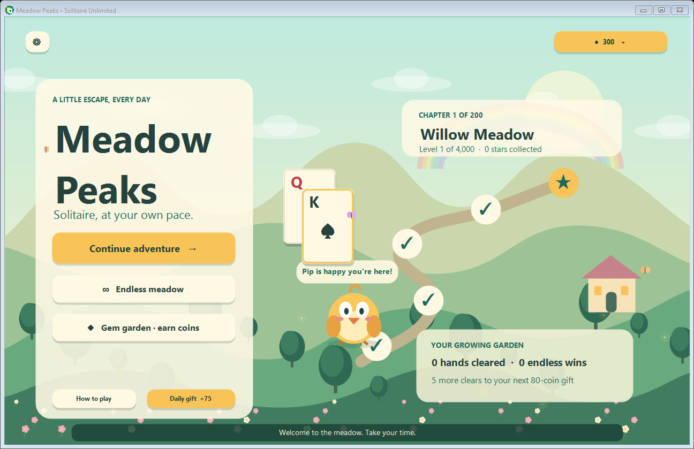
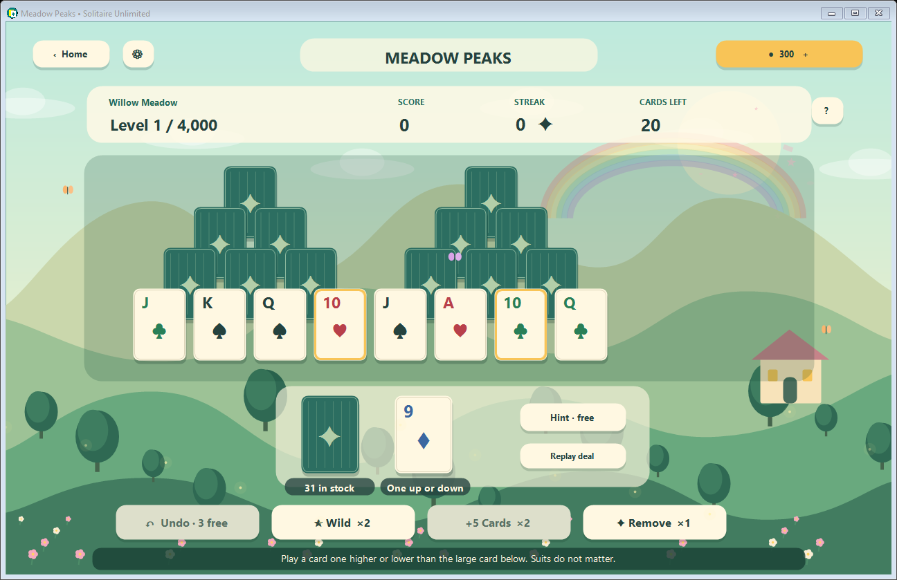
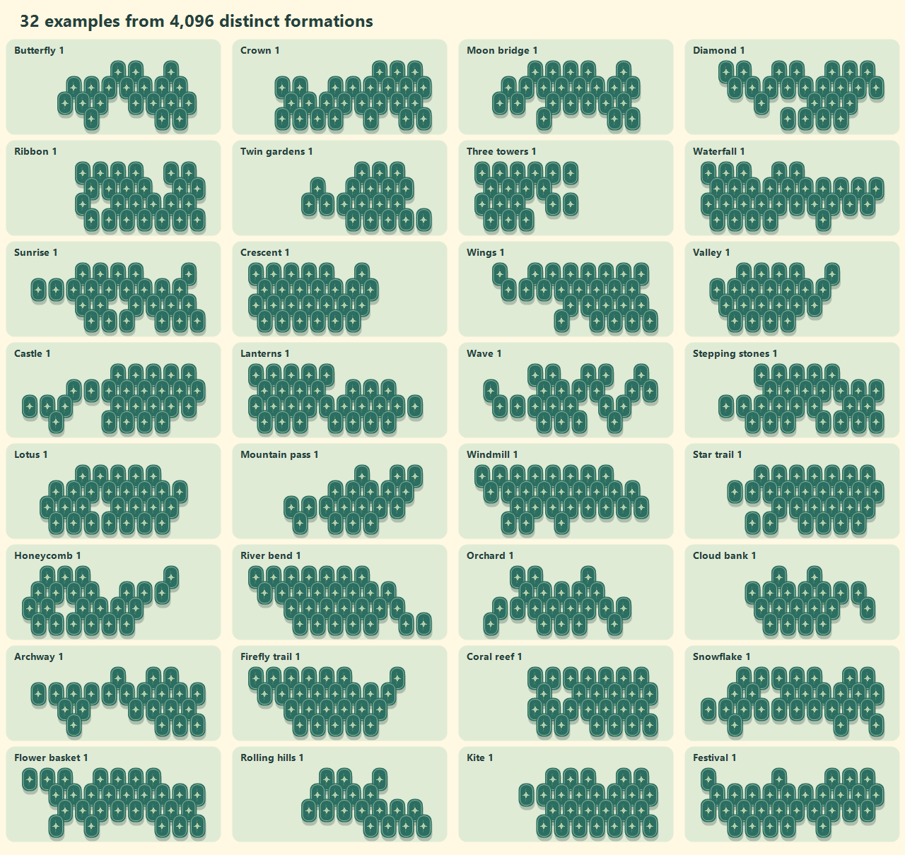
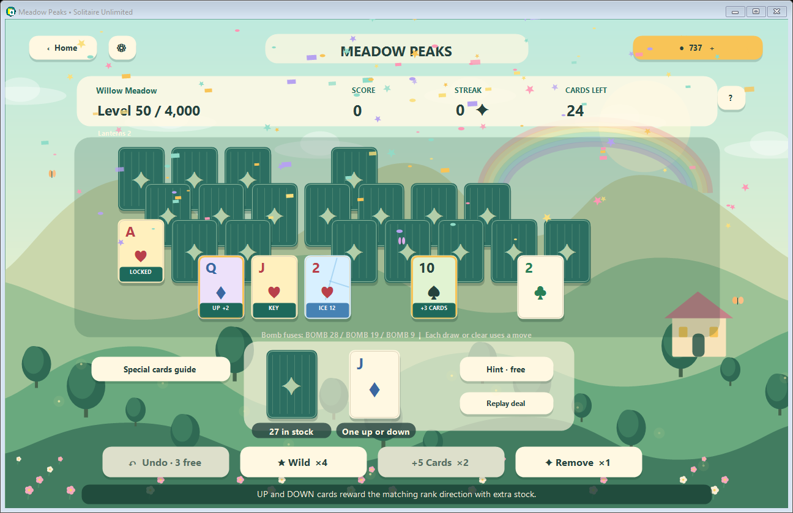
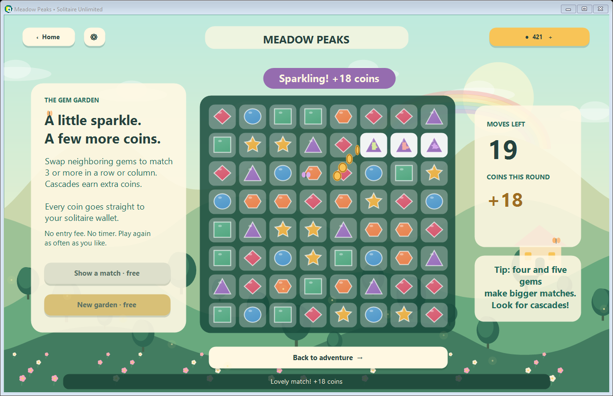
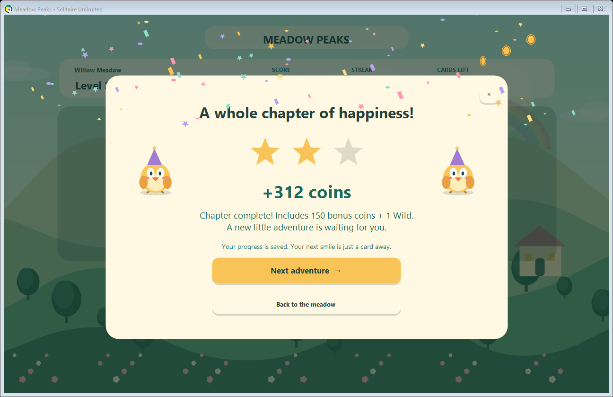

# Meadow Peaks — Solitaire Unlimited

A free, offline Windows solitaire game with an original illustrated countryside,
large cards, **4,000 adventure levels**, an endless mode, and a match-three coin garden.
No accounts, ads, entry fees, energy systems, or real-money purchases.



## Play on Windows

The easiest option is **`MeadowPeaks.exe`**, the single-file Windows x64 build.
Double-click it to play. No extraction, installer, administrator access, .NET
installation, or internet connection is needed. It bundles the game, runtime,
and license notices. The first launch extracts its bundled runtime to a local
cache automatically; subsequent launches reuse it.

Download `MeadowPeaks-win-x64.zip` from a release, extract the **entire** archive,
and run `MeadowPeaks.exe`. Requires x64 Windows 10 or 11. The portable package
includes its runtime. No installer or internet connection is needed.

The source archive does not include a compiled executable. Locally generated
packages are in `artifacts/` and are intentionally excluded from Git.

## What's included

- 4,000 distinct, reproducible adventure deals across 200 map chapters and 20 themed worlds.
- 4,096 distinct generated adventure formations plus classic opening boards, with a complete 52-card base deck per deal. The first four levels introduce the rules; every later campaign level has its own formation. Mirrored and horizontally shifted duplicates are rejected.
- Ice cards that thaw through clears, keys and locks, move-count bombs, +3 stock gifts, and upward/downward +2 stock rewards. Mechanics arrive gradually at levels 5, 10, 20, 35 and 50.
- Colored special cards, live fuse/ice badges, a special-card guide and free replay. Undo restores mechanical state as well as cards.
- Every campaign deal has a verified legal winning path without powerups. These are seeded generated deals, not 4,000 hand-authored puzzles.
- Endless Meadow: new seeded hands, unlimited retries, coins, and a growing garden.
- Wild cards, five extra stock cards, targeted removal, free hints and three free undos per hand.
- A shared coin wallet, helper shop, daily gifts and garden milestones.
- Gem Garden: an 8×8 match-three game with swaps, cascades, hints, automatic dead-board recovery, and immediate coin payouts. Unlimited free 20-move rounds.
- Automatic local saves, active solitaire hand recovery and a previous-save backup.
- 20 world palettes with rainbows, snowy valleys, moonlit lakes, blossoms and a cheerful bird guide, Pip.
- Flying cards, reveals, sparkles, coin trails, combo cheers and confetti celebrations.
- Animated gem swaps, match flashes and cascades, plus original musical rewards when sound is enabled.
- A one-time chapter gift of 150 coins and a Wild for every 20 completed levels.
- Resizable native Windows UI, keyboard focus, accessible control names, distinct gem shapes/suit colors, optional sound and reduced motion.

See [the player guide](docs/PLAYING.txt) for rules, costs, rewards, controls and saves.

## Replaceable components

The game core is a separate, UI-independent class library. Deals, layouts,
solitaire rules, card mechanics, helpers, rewards, coin games, saves, artwork and sound have
replaceable interfaces selected in `src/Composition.cs` and `src/Program.cs`.
Purchases and payouts live in `GameSession`, outside the Windows view. New saves
retain the original board so a generator replacement preserves active hands.

See [the architecture and extension guide](docs/ARCHITECTURE.md) for the component
map, replacement examples, compatibility contracts and legacy-save behavior.







## Build and test

The game is C# / Windows Forms with original GDI+ artwork. There are no third-party
NuGet dependencies, browser wrappers, external art files, or game engine installs.
The project targets .NET 6 to match the available development SDK; the supplied
portable build bundles the installed 6.0.36 runtime. Building requires a .NET SDK
with the .NET 6 Windows desktop targeting pack. Keep the bundled runtime current
when producing releases; a move to a supported LTS target is recommended for ongoing maintenance.

```powershell
dotnet run --project src/MeadowPeaks.csproj
dotnet run --project tests/MeadowPeaks.Tests.csproj -c Release
./scripts/build.ps1
./scripts/build-single-exe.ps1
```

The build script runs the engine tests, publishes a self-contained Windows x64
folder, runs the UI smoke test, and writes `artifacts/MeadowPeaks-win-x64.zip`.
Normal self-contained publishing downloads Microsoft runtime packs from NuGet.
`build-single-exe.ps1` creates and smoke-tests `artifacts/MeadowPeaks.exe` using
standard .NET single-file publishing. No reference examples are included.

For an offline development machine with matching x64 .NET Core and Windows
Desktop runtimes already installed, Python 3 enables an offline fallback:

```powershell
./scripts/build.ps1 -OfflineInstalledRuntime
python scripts/package_source.py
```

The fallback merges the installed runtime manifests and retains the Microsoft
license notices. It produces a portable folder, not a single-file executable.
The source ZIP uses an explicit directory allowlist and excludes all reference examples,
build outputs and private workspace files.

If Windows PowerShell blocks local scripts, run the build with a process-scoped
policy: `powershell -NoProfile -ExecutionPolicy Bypass -File scripts/build.ps1`
(add `-OfflineInstalledRuntime` for the offline fallback).

## Validation

The dependency-free test runner checks all 4,000 level solutions, deck uniqueness,
deal reproducibility, covered-card rules, Ace/King wrap, undo, helpers, 100 complete
match-three rounds, wallet spending, in-progress saves and corrupt-save recovery.
It also installs alternative components and exercises the complete purchase,
powerup, reward, coin-game and save flows through the application coordinator.

`MeadowPeaks.exe --smoke` exercises the real Windows UI: home, map, full winning
hand, reward, helper purchase, gem earnings and resize. It writes a result file
and screenshots beside the executable. Smoke mode does not write to the player's
save. The smoke runner is intended for an interactive Windows desktop; CI runners
without a desktop may need to run only engine tests and validate the UI locally.

## Publish on GitHub

1. Put these original source files in a new public repository. Keep `examples/`
   outside the repository or leave it ignored. The source ZIP is safe to use as
   the initial upload; it never traverses the examples folder.
2. Push to `main` or `master` to run `.github/workflows/build.yml`. The Windows ZIP
   is uploaded as a workflow artifact.
3. Push a version tag such as `v1.0.0` to create a GitHub release with the Windows ZIP.

No repository or release is created by the local build scripts.

## Originality and license

Game code, UI, vector-drawn landscapes, cards and gems were created for this project
and are MIT licensed. No assets, binaries, levels, characters, music or code from
the supplied reference folders are shipped. `examples/` is excluded from Git,
the app project and the source export. Reference games are inspiration for familiar
TriPeaks mechanics, not dependencies or affiliated products. The optional sound
uses Windows' built-in notification chime. Bundled Microsoft runtime files are
covered by their included licenses and third-party notices.
