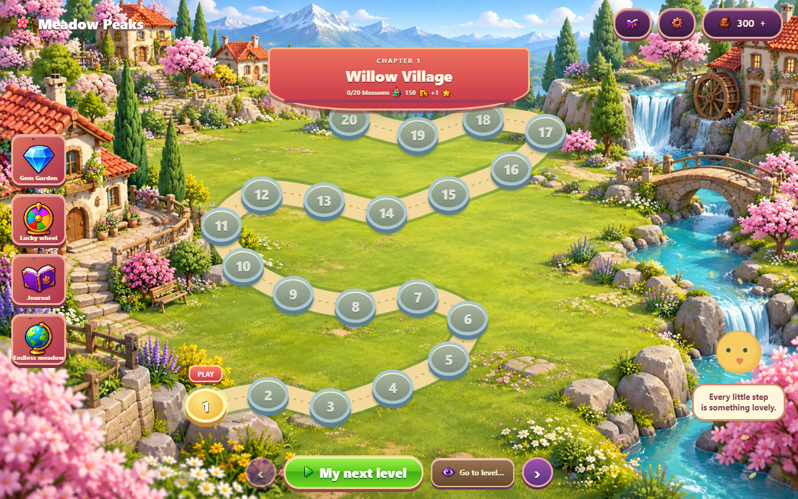

# Meadow Peaks

An illustrated solitaire adventure for Windows and the browser, with **480,000
campaign levels**, 64 formation families, an endless mode and a match-three coin garden.



## Play

[Play in your browser](https://maabra.github.io/solitare-tri-peaks-unlimited/) or
[download MeadowPeaks-2.4.exe](https://github.com/maabra/solitare-tri-peaks-unlimited/releases/download/v2.4.0/MeadowPeaks-2.4.exe).

The Windows x64 EXE bundles .NET and its own WebView2 renderer. Double-click it;
no installer, administrator access, existing browser or network connection is
needed. First launch unpacks the bundled runtimes into a local cache. The download
is larger because the complete renderer is included. Windows 10 or 11 x64 is required.
Older EXEs retain their older interface; use version 2.3 for the current unified UI.

The portable ZIP contains the same game. Extract the entire archive before opening
MeadowPeaks.exe. Source archives contain source and original art, rather than an EXE.

## One interface on both platforms

Windows embeds the exact HTML, CSS, JavaScript and artwork used by GitHub Pages.
The map, cards, animations, menus, padding, helpers, timers and gameplay now have one
shipping implementation. Settings shows the same build version on both platforms.

The map camera keeps scenery, the trail and markers in the same coordinate system.
Its controls stay anchored while the world pans. Drag the scenery or swipe to
explore. The interface adapts to desktop, tall, wide and phone viewports.

Windows keeps the existing JSON profile in Local AppData/MeadowPeaks; the web game
uses browser storage. Saves are local and independent. Export/import in Settings
moves cards, coins, inventory, progress and the saved garden between them.

## Features

- 480,000 seeded levels across 4,800 chapters of 100 levels, with explicit cover graphs and verified solutions.
- 64 formation families: peaks, fans, rings, ribbons, spirals, tilted packets,
  bouquets, and five to eight separate stacks or islands.
- 100 independently painted, narrow portrait chapter worlds with distinct names, matching
  Travel Hub pictures and 100 scrollable stops along a thick, winding road. Later
  journeys reuse these 100 worlds with numbered names. No color filters create variation.
- 100 linked chapter tables and 100 original card-back designs. Completing each chapter earns
  a selectable back and table; later backs add distinct ornamental seals. Existing
  completed chapters unlock their cosmetics automatically.
- Pip the bird introduces activities and special cards as they unlock. Direct map,
  activity and reward-screen links connect the garden, albums, flight and other events.
- 80 original illustrated icons, plus transparent ice, lock-and-chain and vine
  overlays. Suit and rank remain readable under special-card artwork.
- Ice, keys, locks, bombs, directional stock bonuses, armor, vines, lanterns,
  lucky cards, shields, phase gates and color seals. Mechanics arrive gradually;
  capped difficulty upgrades mix them every 100 levels.
- Consumable helpers bought with earned coins. Helpers follow discovery and
  board relevance; temporary bonuses expire rather than becoming permanent boosts.
- Three-second hints with a 15-second recharge; two-second stock draw cooldown;
  five rescue cards lasting ten seconds; a live three-star preview.
- Gem Garden: connected-match highlights, swap and fall animations, refills,
  cascades and immediate coin rewards. Its saved board and one-hour Fresh Garden
  cooldown survive closing and reopening.
- Lucky wheel: one welcome spin, then one per five solitaire wins. Eight equal
  segments award coins or one-use helpers; the prize is saved before the animation.
- Chapter gifts, bonus levels, a journal, daily picnic rewards, favorites,
  reproducible deal codes, sound and reduced motion.
- Stale browser tabs cannot overwrite newer saves. Damaged hands can be discarded
  while preserving valid wallet and map progress. Timed Wild/Thaw expiry updates
  card artwork immediately, and resizing preserves the current tableau.

There are no purchases, ads, accounts, leaderboards or online reward dependencies.
Reference videos, example games and extracted reference frames are excluded from
Git and distribution packages. Original project artwork is included.

## Connected collections in 2.4

100 named chapter sets each link an original portrait scene, card back and table.
Card Studio and Travel Hub use the same chapter identity. Cards face the player
without changing cover geometry; soft scenery blur leaves cards and controls sharp.
The level header uses illustrated chapter and star cues.

Treasure Trail turns rolls earned from new campaign wins into coins, packs and
helpers. Matching Garden uses seeds earned from new wins for a memory-pair game,
with rewards returning to solitaire and the album. See [activity rules](docs/SIDE-GAMES.md).

## Pacing and special worlds in 2.4

New MP24 hands introduce special cards gradually through level 48,000 and reach
full difficulty at 50,000. Existing bonus rewards and activities remain. Nine new
paintings give special modes their own scenery and matching automatic tables.
Old hands and codes keep their rules. See [the progression schedule](docs/PROGRESSION.md).

## Visual clarity in 2.3.1

Larger illustrated controls, short labels, red title ribbons and gold selection
states make the menus easier to scan. Shop cards show art, quantity and price.
Long instructions live behind information buttons and Details, while Pip gives
one short next step.

## Presentation in 2.3

A shared illustrated menu frame connects Map, My cards, Activities and Shop.
Activities are grouped into play, collections and rewards, with useful progress
badges and related-place tabs. Contextual **i** buttons explain activities and
helpers without losing your menu or hand. Consistent buttons, readable headings,
responsive panels and gentle transitions follow the reduced-motion preference.
See [UI details](docs/UI.md).

## Connected journeys in 2.2

MP22 deals add interwoven formations, boxes, circles, arches, braids and linked
shapes. Existing saved hands and MP16/18/19/21 deal codes keep their original rules.
The fitted table surrounds the actual card board and preserves its corners during
resizing. See [journey and customization details](docs/JOURNEY.md).

## Adventures

Albums with 100 stickers, rarity packs and duplicate tokens; daily missions;
lifetime milestones; a monthly voyage; trophy tournaments; offline CPU regatta;
Balloon Trail and the 9x9 Souvenir Hunt; bingo; weekly ticket trails; chapter
chests and postcards. New MP21 hands add TNT, Joker, two-hit ice, moving ranks,
tornadoes, fog and five-card streak stock rewards. The browser asks for local-save
permission before play. See [all rules and compatibility details](docs/ADVENTURES.md).

## Build and verify

Install the .NET 6 SDK, Node.js and Python. Windows builds need Windows.

```powershell
./scripts/prepare_webview_runtime.ps1
./scripts/build.ps1
./scripts/build-single-exe.ps1 -OutputName MeadowPeaks-2.4.exe
python scripts/package_web.py
python scripts/package_source.py
```

The runtime preparation script downloads Microsoft's pinned official Fixed Version
WebView2 package and verifies its SHA-256. The runtime is kept under ignored artifacts,
never in the source archive. See [architecture](docs/ARCHITECTURE.md) for the host boundary,
[web notes](docs/WEB.md) for shared presentation and [player guide](docs/PLAYING.txt).

```powershell
node --test web/tests/engine.test.mjs web/tests/adventure.test.mjs web/tests/journey.test.mjs web/tests/progression.test.mjs web/tests/side-activities.test.mjs
dotnet run --project tests/MeadowPeaks.Tests.csproj -c Release -- --effects-only
# Exhaustive formation and solution verification:
dotnet run --project tests/MeadowPeaks.Tests.csproj -c Release -- --story-all
# Start a local server before real-browser checks:
python -m http.server 8765 --bind 127.0.0.1 --directory web
python scripts/test_web_browser.py
python scripts/test_presentation_edges.py
```

Browser checks use Python Playwright with Microsoft Edge. Windows builds run a
shared-renderer UI smoke test using a separate test profile and workspace cache.
The native C# domain remains available for import compatibility, deterministic
fixtures and replaceable component tests. New presentation changes belong in web/.

Original code/art use the project LICENSE. Bundled Microsoft components keep their
own license and notice files; see [third-party notes](docs/THIRD_PARTY.md).
