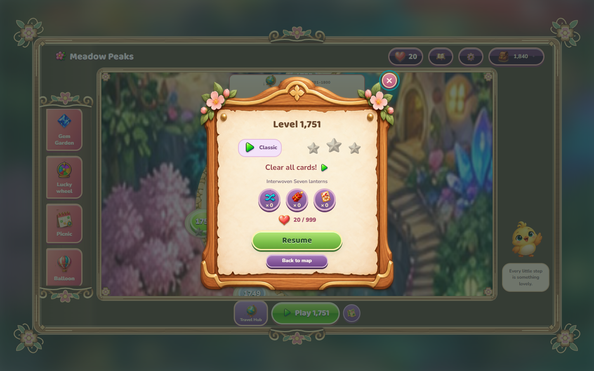
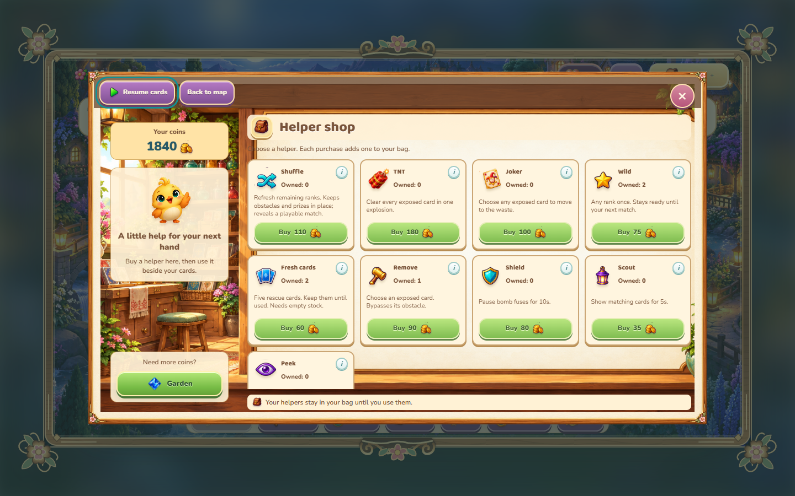
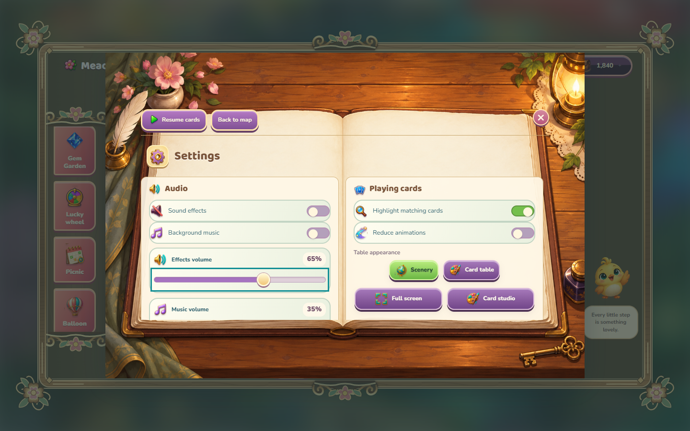

# Meadow Peaks

A cozy solitaire journey with Pip, illustrated villages, spinning cards and little treasures to collect. Play in your browser or on Windows.

**[Play online](https://maabra.github.io/solitaire-tri-peaks-unlimited/)** · [Windows downloads](https://github.com/maabra/solitaire-tri-peaks-unlimited/releases) · [Source](https://github.com/maabra/solitaire-tri-peaks-unlimited)


## A journey with an end

The campaign has **10,000 levels across 100 chapters of 100 levels**. Every chapter has its own original illustrated map, name, collectible card back and table. The campaign stops at the last original art set; there are no numbered repeats of the same worlds. Endless hands remain available after the final level.

The opening chapter introduces the basics at a gentle pace. Later mechanics, helper discoveries and activities fit the shorter campaign. Every generated hand constructs and replays a winning path under its actual rules.


## How to play

Choose an uncovered card one rank higher or lower than the waste card. Ace connects to both King and Two. Draw from the blue stock pile when you need another rank. Build streaks, watch obstacle badges, and spend earned coins on one-use helpers.

Most hands are short. The 128 formation families include fans, bouquets, loops, terraces and stacks. Occasional long gardens introduce deeper formations of 60, 80, 104 or 120 cards. Bonus and special-goal levels add variety along the road.

Play opens a compact notice-board preview before starting. Pausing, browsing and resuming are free. Losing or leaving an unfinished attempt costs one heart; rewards and Gem Garden provide more. You start with three hearts and can keep up to 999.



## Discover along the road

The first chapter introduces Gem Garden, the daily picnic, Lucky Wheel, albums, trophies, flights, bingo and sailing. Travel Hub and Card Studio open with the second chapter.

| Level | New discovery |
| --- | --- |
| 50 | Gift cards add stock |
| 125 / 150 | Shuffle helper / ice cards |
| 350 | Keys and locks |
| 600 | Bombs and Treasure Trail |
| 1,100 / 1,700 | Moving ranks / armor |
| 2,300 / 2,500 | Lanterns / Matching Garden |
| 2,850 / 3,650 | Lucky cards / vines |
| 4,450 / 5,650 | Shields / tornadoes |
| 7,000 / 8,600 | Fog / phase gates |
| 9,600 | Color seals; final chapters combine the full ruleset |

Helpers unlock through progress and obstacle discovery. Pip introduces places, explains tools, and offers a tip after repeated mistakes. Rewards are saved before their animations, so interrupted effects cannot duplicate prizes.



## More little adventures

| Place | What you do |
| --- | --- |
| Gem Garden | Match jewels for coins and hearts, even when out of lives |
| Helper shop | Buy Wild, Fresh cards, Remove and other discovered tools with earned coins |
| Albums | Open packs, complete sticker sets and exchange duplicate tokens |
| Balloon Trail and Souvenir Hunt | Win flights, earn arrows and uncover island treasures |
| Bingo | Spend draws earned from wins to complete lines |
| Regatta and Voyage | Advance sailing and reward tracks; Regatta rivals are offline CPU crews |
| Treasure Trail and Matching Garden | Earn rolls and seeds from new campaign wins, then play for prizes |
| Picnic and Milestones | Collect rewards for the things you already do while playing |
| Chapter collections | Earn stars, postcards, chests, card backs and tables |


## A full-size game window

The game occupies a fixed **1280 × 720** scene, centered over blurred scenery. Smaller windows have scrollbars instead of shrinking text and icons. The road and left activity list scroll independently. Menus use illustrated notice boards, a shop counter, a book or a collection desk, with internal scrolling where needed.

Cards arc, flip and sparkle into the waste. Blossoms decorate the outside frame; controls stay inside the playing area. Settings include reduced motion, hints, illustrated-scene or collected-table play, and separate sound and music volume controls. Fonts and game assets are bundled locally.



## Your adventure stays yours

There are no ads, paid purchases, accounts or online reward requirements. The browser asks permission to save locally. Windows and browser saves are independent; use **Settings → Saved adventure → Export / Import** to move backups between them. Browser progress belongs to its browser and site origin.

Older saves migrate without losing coins, hearts or helpers. Progress in retained levels stays in place. Retired level records are archived inside the exported save, and earned designs from repeated chapters map to their original art. An unfinished hand beyond level 10,000 continues as an endless hand with its board intact. Invalid saves are rejected; backup recovery and stale-tab checks protect existing progress.

Windows packages bundle .NET and WebView2 for offline play. Extract the entire ZIP before launching `MeadowPeaks.exe`, or use the packaged single EXE. The Releases page lists available Windows builds; the live browser link follows `main`.

## Run and build

Serve the browser game over HTTP:

```powershell
python -m http.server 8765 --directory web
```

Open `http://127.0.0.1:8765/`. Windows development requires the **.NET 10 SDK**, Node.js and Python:

```powershell
./scripts/prepare_webview_runtime.ps1
./scripts/build.ps1
./scripts/build-single-exe.ps1
```

Runtime preparation downloads and verifies the pinned Microsoft WebView2 package. Build output goes to `artifacts/`; reference material under `examples/` is excluded from distributions.

C# owns the Windows host, compatibility domain, campaign catalog and typed interface content. The browser and Windows WebView use the same generated campaign and UI definitions. After changing [CampaignContent.cs](src/MeadowPeaks.Core/Content/CampaignContent.cs) or [InterfaceCatalog.cs](src/MeadowPeaks.Core/Content/InterfaceCatalog.cs), regenerate and check:

```powershell
dotnet run --project tools/MeadowPeaks.ContentExporter -- .
dotnet run --project tools/MeadowPeaks.ContentExporter -- --check .
```

## Check the game

```powershell
dotnet run --project tests/MeadowPeaks.Tests.csproj -c Release
node --test web/tests/*.test.mjs
node scripts/validate_chapter_collection.mjs
node scripts/verify_adventure_deals.mjs --all
node scripts/verify_long_deals.mjs
python scripts/test_campaign_cap.py
python scripts/audit_ui.py
```

Checks cover deterministic deals, winning witnesses, obstacles, saves, transactions, migration, layout, navigation, hearts, audio and interrupted animations. The UI audit checks 26 screens at three window sizes. Refresh documentation screenshots with `python scripts/capture_readme_screenshots.py` while the local server is running; it uses an isolated sample profile. Browser scripts require Playwright and Microsoft Edge.

See [LICENSE](LICENSE) and [third-party notices](docs/THIRD_PARTY.md).
