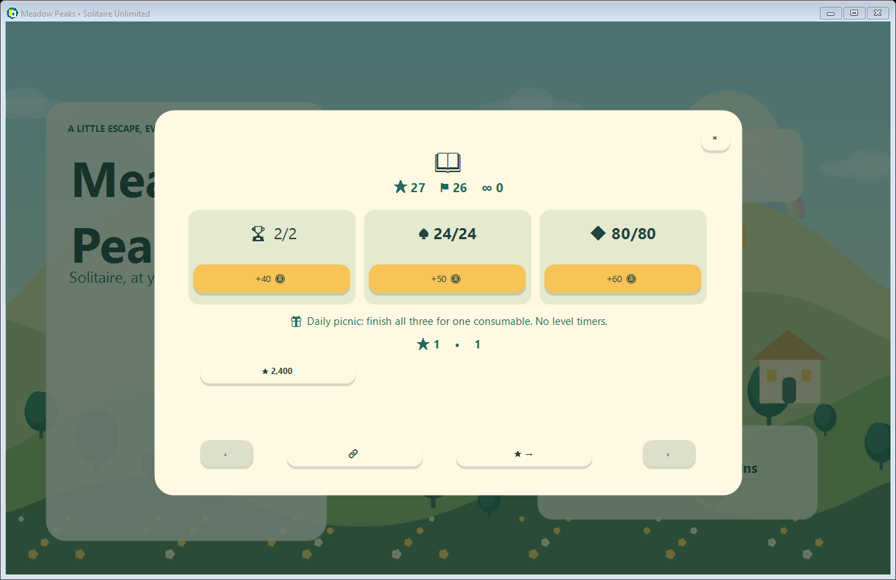
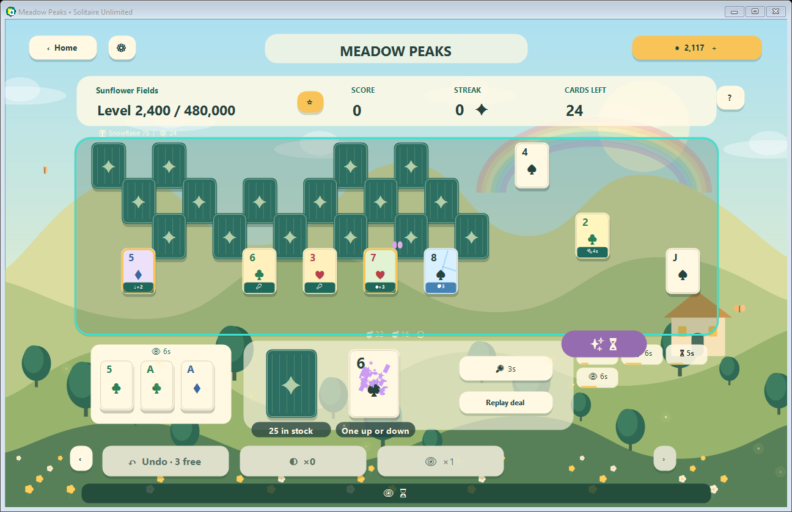
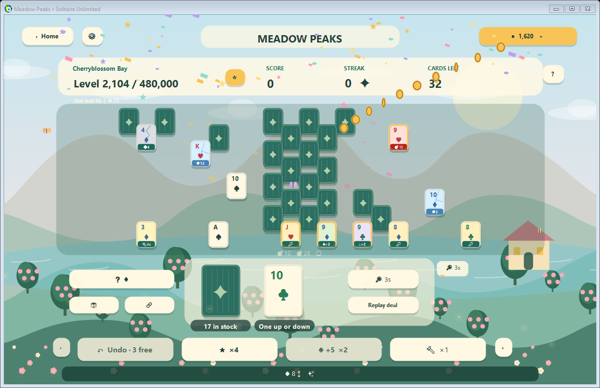
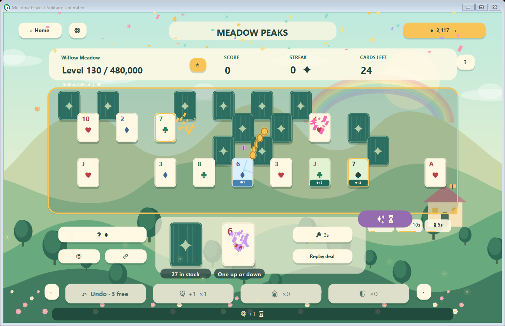

# Meadow Peaks — Solitaire Unlimited

A free, offline Windows solitaire game with an original illustrated countryside,
large cards, **480,000 adventure levels**, an endless mode, and a match-three coin garden.
No accounts, ads, entry fees, energy systems, or real-money purchases.


## Play on Windows

The latest local build is **`MeadowPeaks-1.6.exe`** (the existing `MeadowPeaks.exe` may still be an earlier running build). Close an older game before opening the new one so both do not save the same profile.

The easiest release option is **`MeadowPeaks.exe`**, the single-file Windows x64 build.
Double-click it to play. No extraction, installer, administrator access, .NET
installation, or internet connection is needed. It bundles the game, runtime,
and license notices. The first launch extracts its bundled runtime to a local
cache automatically; subsequent launches reuse it.

Download `MeadowPeaks-win-x64.zip` from a release, extract the **entire** archive,
and run `MeadowPeaks.exe`. Requires x64 Windows 10 or 11. The portable package
includes its runtime. No installer or internet connection is needed.

The source archive does not include a compiled executable. Locally generated
packages are in `artifacts/` and are intentionally excluded from Git.

## What's included

- 480,000 distinct, reproducible adventure deals across 24,000 map chapters and 20 themed worlds.
- 480,000 distinct generated adventure formations plus classic opening boards, drawn from a standard 52-card base deck. Later tiers trim only surplus stock. The first four levels introduce the rules; every later campaign level has its own formation. Mirrored and horizontally shifted duplicates are rejected.
- 4-8 overlapping card rows with adaptive card placement and readable exposed cards.
- Armored cards start at two hits and cap at four; vines start at two consecutive clears and cap at three. Lantern, clover and shield cards start temporary effects.
- Ice cards that thaw through clears, keys and locks, move-count bombs, +3 stock gifts, and upward/downward +2 stock rewards. Gift cards arrive at 50, then ice at 100, locks at 200, bombs at 300, directional cards at 400, armor at 500, lanterns at 600, clovers at 700, vines at 800 and shields at 900.
- Every 100 levels introduces or emphasizes a component. After level 900, rotating upgrades add thicker ice, multi-key locks, tighter fuses, layered armor, longer vine streaks and smaller stock reserves. Strength caps keep the endgame fair; later tiers vary combinations.
- Deeper boards arrive at levels 300, 700, 1,300 and 2,100.
- Icon badges, live fuse/ice counters, an illustrated guide, hover explanations, free replay and fresh-deck remix. Undo restores card state without restoring elapsed effect time.
- Hints show matches for 3 seconds and recharge in 15 seconds. Helpers share a 5-second recharge. Wilds expire after 12 seconds if unused.
- Consumable +1 stock-per-clear (10s), thaw (8s), shield (10s) and scout (5s) helpers. No permanent upgrades or level countdowns.
- Phase gates at level 2,000 alternate after successful moves. Color seals at 2,300 require matching the waste pile color as well as rank.
- Four more consumables: lock bypass (6s), pruning (8s), phase bypass (6s), and next-three-stock preview (6s). Eleven helper types in total.
- A journal with daily picnic goals, once-per-day coin/consumable rewards, saved level favorites and a three-star hunt shortcut.
- Checksummed deal codes reproduce current-version cards and formations, with campaign unlock checks. Share and import are explicit user actions.
- Bonus opening varieties: Glow (8s matches), Harvest (6s +1 stock per clear), Shelter (6s fuse shield), introduced after their corresponding mechanic unlocks.
- Every 25th campaign level grants a one-time 125-coin bonus and one consumable on first completion.
- Every campaign deal has a verified legal winning path without powerups. These are seeded generated deals, not hand-authored puzzles.
- Endless Meadow: new seeded hands, unlimited retries, coins, and a growing garden.
- Wild cards, five extra stock cards, targeted removal, free hints and three free undos per hand.
- A shared coin wallet, helper shop, daily gifts and garden milestones.
- Gem Garden: an 8×8 match-three game with swaps, cascades, hints, automatic dead-board recovery, and immediate coin payouts. Unlimited free 20-move rounds.
- Automatic local saves, active solitaire hand recovery and a previous-save backup.
- 20 world palettes with rainbows, snowy valleys, moonlit lakes, blossoms and a cheerful bird guide, Pip.
- Flying cards, reveals, sparkles, coin trails, combo cheers and confetti celebrations.
- Animated gem swaps, match flashes and cascades, plus original musical rewards when sound is enabled.
- A one-time chapter gift of 150 coins and a Wild for every 20 completed levels.
- Resizable native Windows UI, keyboard focus, accessible control names, distinct gem shapes/suit colors, optional sound and reduced motion.

See [the player guide](docs/PLAYING.txt) for rules, costs, rewards, controls and saves.


## Replay and playtime

480,000 campaign levels provide an estimated 8,000 hours at one minute per level.
This is a content planning assumption, not a measured or guaranteed playtime.
For the requested 10,000-hour target, at most 2,000 hours are attributed to
Endless Meadow. Endless is still freely playable; the budget is not a lockout.
Free remix creates fresh reproducible card deals at the current level. Scores,
stars, repeat payouts and Gem Garden support replay without permanent power boosts.
All campaign winning paths are tested without relying on temporary effects.

## Replaceable components

The game core is a separate, UI-independent class library. Deals, layouts,
solitaire rules, card mechanics, helpers, rewards, coin games, saves, artwork and sound have
replaceable interfaces selected in `src/Composition.cs` and `src/Program.cs`.
Purchases and payouts live in `GameSession`, outside the Windows view. New saves
retain the original board so a generator replacement preserves active hands.

See [the architecture and extension guide](docs/ARCHITECTURE.md) for the component
map, replacement examples, compatibility contracts and legacy-save behavior.








## Build and test

The game is C# / Windows Forms with original GDI+ artwork. There are no third-party
NuGet dependencies, browser wrappers, external art files, or game engine installs.
The project targets .NET 6 to match the available development SDK; the supplied
portable build bundles the installed 6.0.36 runtime. Building requires a .NET SDK
with the .NET 6 Windows desktop targeting pack. Keep the bundled runtime current
when producing releases; a move to a supported LTS target is recommended for ongoing maintenance.

```powershell
dotnet run --project src/MeadowPeaks.csproj
dotnet run --project tests/MeadowPeaks.Tests.csproj -c Release
./scripts/build.ps1
./scripts/build-single-exe.ps1
```

The build script runs the engine tests, publishes a self-contained Windows x64
folder, runs the UI smoke test, and writes `artifacts/MeadowPeaks-win-x64.zip`.
Normal self-contained publishing downloads Microsoft runtime packs from NuGet.
`build-single-exe.ps1` creates and smoke-tests `artifacts/MeadowPeaks.exe` using
standard .NET single-file publishing. Use `-OutputName MeadowPeaks-1.6.exe` to create a versioned file while an older EXE is in use. No reference examples are included.

For an offline development machine with matching x64 .NET Core and Windows
Desktop runtimes already installed, Python 3 enables an offline fallback:

```powershell
./scripts/build.ps1 -OfflineInstalledRuntime
python scripts/package_source.py
```

The fallback merges the installed runtime manifests and retains the Microsoft
license notices. It produces a portable folder, not a single-file executable.
The source ZIP uses an explicit directory allowlist and excludes all reference examples,
build outputs and private workspace files.

If Windows PowerShell blocks local scripts, run the build with a process-scoped
policy: `powershell -NoProfile -ExecutionPolicy Bypass -File scripts/build.ps1`
(add `-OfflineInstalledRuntime` for the offline fallback).

## Validation

The dependency-free test runner checks all 480,000 adventure winning paths with timed effects expired, all formation fingerprints, the original 4,000 legacy deals, deck uniqueness,
deal reproducibility, covered-card rules, Ace/King wrap, undo, helpers, 100 complete
match-three rounds, wallet spending, in-progress saves and corrupt-save recovery.
It also installs alternative components and exercises the complete purchase,
powerup, reward, coin-game and save flows through the application coordinator.

`MeadowPeaks.exe --smoke` exercises the real Windows UI: home, map, full winning
hand, reward, helper purchase, gem earnings and resize. It writes a result file
and screenshots beside the executable. Smoke mode does not write to the player's
save. The smoke runner is intended for an interactive Windows desktop; CI runners
without a desktop may need to run only engine tests and validate the UI locally.

## Publish on GitHub

1. Put these original source files in a new public repository. Keep `examples/`
   outside the repository or leave it ignored. The source ZIP is safe to use as
   the initial upload; it never traverses the examples folder.
2. Push to `main` or `master` to run `.github/workflows/build.yml`. The Windows ZIP
   is uploaded as a workflow artifact.
3. Push a version tag such as `v1.0.0` to create a GitHub release with the Windows ZIP.

No repository or release is created by the local build scripts.

## Originality and license

Game code, UI, vector-drawn landscapes, cards and gems were created for this project
and are MIT licensed. Reference games are inspiration for familiar
TriPeaks mechanics, not dependencies or affiliated products. The optional sound
uses Windows' built-in notification chime. Bundled Microsoft runtime files are
covered by their included licenses and third-party notices.
