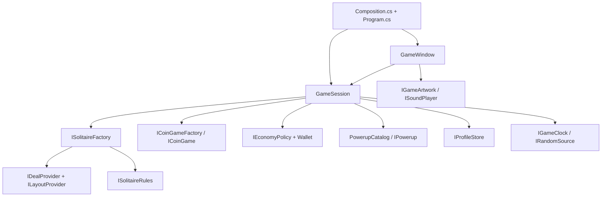

# Replacing game components

The game uses constructor injection and small interfaces. The native Windows
view depends on `GameSession` and presentation interfaces. The reusable core
does not reference Windows Forms, graphics, sound, or the filesystem UI.



## Where things belong

| Part | Default implementation | Replace through |
| --- | --- | --- |
| Deal generation / authored level source | `SeededDealProvider` | `IDealProvider` in `SolitaireFactory` |
| Overlapping board layouts | `PeakLayouts` | `ILayoutProvider` in `SeededDealProvider` |
| Rank adjacency and card coverage | `TriPeaksRules` | `ISolitaireRules` in the generator and hand factory |
| Solitaire engine / hand creation | `Hand`, `SolitaireFactory` | `ISolitaireHand`, `ISolitaireFactory` |
| Coin minigame | `GemGame`, `GemGameFactory` | `ICoinGame`, `ICoinGameFactory` |
| Win rewards, paid undo and gifts | `StandardEconomyPolicy` | `IEconomyPolicy` |
| Helpers and prices | `WildPowerup`, `ExtraCardsPowerup`, `RemovePowerup` | `IPowerup` entries in `PowerupCatalog` |
| Saving | `JsonProfileStore` | `IProfileStore`; `MemoryProfileStore` is a working alternative |
| Time and random seeds | `LocalGameClock`, `RandomSource` | `IGameClock`, `IRandomSource` |
| Cards, gems, backgrounds and theme colors | `MeadowArtwork` | `IGameArtwork` passed to `GameWindow` and its controls |
| Sound | `WindowsChime` | `ISoundPlayer` |

`src/Composition.cs` selects the core implementations in one place. `Program.cs`
selects the save store, artwork and sound. Implement a contract and change the
corresponding constructor argument. No service locator, dependency injection
package, reflection-based discovery, or inheritance from the window is required.

`GameSession` owns game commands and coordinates the wallet, inventory, rewards,
progression and persistence. The view sends commands such as `BuyPowerup`,
`UsePowerup`, `PlayGems`, `Undo` and `CompleteHand`; it does not calculate or
mutate payouts. The view may edit presentation preferences on `Profile`.

## Example: change rewards

This policy doubles win coins while retaining all other default rules:

```csharp
public sealed class DoubleWinCoins : IEconomyPolicy
{
    readonly StandardEconomyPolicy defaults = new();
    public int UndoCost => defaults.UndoCost;
    public int DailyGift => defaults.DailyGift;
    public int GardenGift => defaults.GardenGift;
    public int GardenInterval => defaults.GardenInterval;
    public WinReward Reward(WinContext context)
    {
        var reward = defaults.Reward(context);
        return reward with { Coins = checked(reward.Coins * 2) };
    }
}
```

Change `new StandardEconomyPolicy()` to `new DoubleWinCoins()` in `Composition`.
The wallet, win display, undo price, and gift buttons use the injected policy.

## Example: add or replace a helper

Implement `IPowerup` with a stable `Id`, name, description, price, eligibility
check and action. Add the instance to the `PowerupCatalog` constructor in
`Composition`. `RequiresTarget` tells the view to ask for an exposed card.

The shop and toolbar enumerate the catalog; they do not contain a switch for
each helper type. Both page through catalogs larger than three entries. New
IDs are persisted in `Progress.Items` automatically. Existing IDs `wild`,
`extra` and `remove` retain their original save fields and inventories.
Reuse an ID only when the replacement should inherit that helper's stock.

`CanUse` must not mutate the hand. `Apply` returns `true` only when the action
succeeds; returning `false` must leave the hand unchanged. The coordinator
consumes inventory only after a successful action. Built-in helper operations
clear undo history to prevent inventory recovery through undo.

## Compatibility between parts

Replacement parts must satisfy their contracts, not just compile. Rank rules
must agree with the deal provider. The built-in generator assumes a standard
52-card deck and ranks 1–13; sufficiently different rules need a matching deal
provider. Win stars remain 1–3 and coin amounts must be non-negative.

The current board view uses four overlapping rows, ranks 1–13 and four suits.
`ICoinGame` alternatives can reuse the current view when they expose an 8×8
board with gem kinds 0–5 and neighboring swaps. Different board geometry or
interaction needs a matching presentation change. The core library can be
used by a different UI without Windows dependencies.

Components are selected when constructing a session. This is not a runtime
plugin loader; changing compiled implementations requires rebuilding the app.

## Saves and generator changes

The original version-1 profile fields remain readable. New `SavedRun` objects
also include `DealtBoard`, the original board and starting stock. Restoring or
replaying these hands uses the stored board even if the provider for new levels
has changed. The original legacy provider is passed separately to
`SolitaireFactory` for older saves that contain only a seed. Keep that legacy
provider unchanged when installing a new provider.

The JSON store handles atomic replacement, backup and profile validation. A
different store must return an independent profile and persist the same schema
if it needs to interoperate with JSON saves. Undo history and unfinished coin
rounds remain session-only. Earned coins and the active solitaire hand save.
Persisted DTOs (`Progress`, `SavedRun`, `Deal`) are deliberately separate from
services. Treat returned game-state collections as read-only.

## Verification

```powershell
dotnet run --project tests/MeadowPeaks.Tests.csproj -c Release
```

The tests reference the **actual core project**, not linked source copies.
Alongside all 2,000 default solutions, `ComponentSwapTests.cs` installs a tiny
alternate deal source, a different layout provider and rank rule, a custom
helper ID, another economy, a substitute coin game, memory/JSON stores, and
deterministic time/randomness. It exercises purchases, consumption, rewards,
failed commands, daily claims, provider changes and legacy save recovery.
A campaign fingerprint recorded from the original release also checks that
all 2,000 boards, stock orders and layouts remain unchanged by the refactor.

`MeadowPeaks.exe --smoke` checks the assembled Windows application through its
actual buttons. `scripts/build.ps1` runs both sets of checks before packaging.
