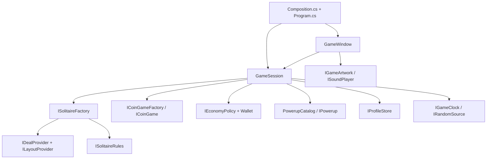

# Replacing game components

The game uses constructor injection and small interfaces. The native Windows
view depends on `GameSession` and presentation interfaces. The reusable core
does not reference Windows Forms, graphics, sound, or the filesystem UI.



## Where things belong

| Part | Default implementation | Replace through |
| --- | --- | --- |
| Chapter metadata and campaign length | `MeadowCampaign` | `ICampaignCatalog` in `GameSession` |
| Deal generation / authored level source | `SeededDealProvider` | `IDealProvider` in `SolitaireFactory` |
| Overlapping board layouts | `PeakLayouts` | `ILayoutProvider` in `SeededDealProvider` |
| Rank adjacency and card coverage | `TriPeaksRules` | `ISolitaireRules` in the generator and hand factory |
| Solitaire engine / hand creation | `Hand`, `SolitaireFactory` | `ISolitaireHand`, `ISolitaireFactory` |
| Coin minigame | `GemGame`, `GemGameFactory` | `ICoinGame`, `ICoinGameFactory` |
| Win rewards, paid undo and gifts | `StandardEconomyPolicy` | `IEconomyPolicy` |
| Helpers and prices | `WildPowerup`, `ExtraCardsPowerup`, `RemovePowerup` | `IPowerup` entries in `PowerupCatalog` |
| Saving | `JsonProfileStore` | `IProfileStore`; `MemoryProfileStore` is a working alternative |
| Time and random seeds | `LocalGameClock`, `RandomSource` | `IGameClock`, `IRandomSource` |
| Cards, gems, backgrounds and theme colors | `MeadowArtwork` | `IGameArtwork` passed to `GameWindow` and its controls |
| Sound | `MeadowSoundtrack` | `ISoundPlayer`, optional `IGameSoundtrack` cues |

`EffectScene` is a presentation component passed into `GameWindow` from the
composition root. Its `IVisualEffect` objects animate cards, gems, coins,
particles and cheers without mutating game state. The owned `EffectsOverlay`
draws above native controls and stays click-through. The built-in sound player
is now `MeadowSoundtrack`, implementing optional `IGameSoundtrack` cues while
retaining `ISoundPlayer` compatibility.
Animated controls sample a cached scene backdrop, so every gem frame does not
repaint the whole landscape 64 times. Reduced motion suppresses both scene
effects and control transitions.

`IAnimatedCoinGame` is an optional extension to `ICoinGame`. `GemGame` records
immutable swap/match/drop frames; the UI plays them after the logical move has
resolved and saved its earnings. Alternative coin games can omit visual history.
The UI blocks another gem swap until playback finishes, and reduced motion skips
the playback. Chapter gift values belong to `IEconomyPolicy`, while collected
chapter gifts are saved to prevent duplicate rewards.

`src/Composition.cs` selects the core implementations in one place. `Program.cs`
selects the save store, artwork and sound. Implement a contract and change the
corresponding constructor argument. No service locator, dependency injection
package, reflection-based discovery, or inheritance from the window is required.

`GameSession` owns game commands and coordinates the wallet, inventory, rewards,
progression and persistence. The view sends commands such as `BuyPowerup`,
`UsePowerup`, `PlayGems`, `Undo` and `CompleteHand`; it does not calculate or
mutate payouts. The view may edit presentation preferences on `Profile`.

## Example: change rewards

This policy doubles win coins while retaining all other default rules:

```csharp
public sealed class DoubleWinCoins : IEconomyPolicy
{
    readonly StandardEconomyPolicy defaults = new();
    public int UndoCost => defaults.UndoCost;
    public int DailyGift => defaults.DailyGift;
    public int GardenGift => defaults.GardenGift;
    public int GardenInterval => defaults.GardenInterval;
    public WinReward Reward(WinContext context)
    {
        var reward = defaults.Reward(context);
        return reward with { Coins = checked(reward.Coins * 2) };
    }
}
```

Change `new StandardEconomyPolicy()` to `new DoubleWinCoins()` in `Composition`.
The wallet, win display, undo price, and gift buttons use the injected policy.

## Example: add or replace a helper

Implement `IPowerup` with a stable `Id`, name, description, price, eligibility
check and action. Add the instance to the `PowerupCatalog` constructor in
`Composition`. `RequiresTarget` tells the view to ask for an exposed card.

The shop and toolbar enumerate the catalog; they do not contain a switch for
each helper type. Both page through catalogs larger than three entries. New
IDs are persisted in `Progress.Items` automatically. Existing IDs `wild`,
`extra` and `remove` retain their original save fields and inventories.
Reuse an ID only when the replacement should inherit that helper's stock.

`CanUse` must not mutate the hand. `Apply` returns `true` only when the action
succeeds; returning `false` must leave the hand unchanged. The coordinator
consumes inventory only after a successful action. Built-in helper operations
clear undo history to prevent inventory recovery through undo.

## Compatibility between parts

Replacement parts must satisfy their contracts, not just compile. Rank rules
must agree with the deal provider. The built-in generator assumes a standard
52-card deck and ranks 1–13; sufficiently different rules need a matching deal
provider. Win stars remain 1–3 and coin amounts must be non-negative.

The current board view uses four to eight overlapping rows, ranks 1–13 and four suits.
`ICoinGame` alternatives can reuse the current view when they expose an 8×8
board with gem kinds 0–5 and neighboring swaps. Different board geometry or
interaction needs a matching presentation change. The core library can be
used by a different UI without Windows dependencies.

Components are selected when constructing a session. This is not a runtime
plugin loader; changing compiled implementations requires rebuilding the app.

## Saves and generator changes

The original version-1 profile fields remain readable. New `SavedRun` objects
also include `DealtBoard`, the original board and starting stock. Restoring or
replaying these hands uses the stored board even if the provider for new levels
has changed. The original legacy provider is passed separately to
`SolitaireFactory` for older saves that contain only a seed. Keep that legacy
provider unchanged when installing a new provider.

The JSON store handles atomic replacement, backup and profile validation. A
different store must return an independent profile and persist the same schema
if it needs to interoperate with JSON saves. Undo history and unfinished coin
rounds remain session-only. Earned coins and the active solitaire hand save.
Persisted DTOs (`Progress`, `SavedRun`, `Deal`) are deliberately separate from
services. Treat returned game-state collections as read-only.

## Verification

```powershell
dotnet run --project tests/MeadowPeaks.Tests.csproj -c Release
```

The tests reference the **actual core project**, not linked source copies.
Alongside all 4,000 default solutions, `ComponentSwapTests.cs` installs a tiny
alternate deal source, a different layout provider and rank rule, a custom
helper ID, another economy, a substitute coin game, memory/JSON stores, and
deterministic time/randomness. It exercises purchases, consumption, rewards,
failed commands, daily claims, provider changes and legacy save recovery.
A campaign fingerprint recorded from the original release also checks that
the original 2,000 boards, stock orders and layouts remain unchanged by the refactor.

`MeadowPeaks.exe --smoke` checks the assembled Windows application through its
actual buttons. `scripts/build.ps1` runs both sets of checks before packaging.


## Adventure mechanics (1.2)

`AdventureLayouts : ILayoutProvider` generates formations on demand. A fixed
asymmetric anchor set and a permuted combinatorial rank select 11 of 22 optional
positions (705,432 combinations). Each of the 480,000 campaign indices therefore
has its own occupancy pattern. Four to eight rows are introduced gradually.
There is no startup catalog build or persistent shape cache. Tests normalize
horizontal translations and mirrors and check every formation for uniqueness,
determinism, bounds and row spacing. The first four tutorial layouts stay classic.
`CardBounds` shares geometry between rendering, controls and effects; card width
and row spacing adjust to depth without rendering overlaps outside rule coverage.
`AdventureDealProvider : IDealProvider` decorates a seeded legal witness with
special cards. Keys precede locks, ice thresholds allow the witness, bomb fuses
include a move margin, and bonus stock appends behind the original stock. All
480,000 adventure witnesses are executed against the actual hand in tests.

`CardKind` and `Strength` are optional card metadata. `ICardMechanics` is an
injectable stateless policy for eligibility, badges, per-move effects and stock
rewards. `Hand` stores `MechanicState` in both its undo snapshots and `SavedRun`;
replay resets it. Pass a different policy as the optional final argument of
`SolitaireFactory` to replace mechanical behavior. `IAdventureHand` is an
optional view capability, so alternative plain hands remain compatible.

The composition root uses adventure generation for new hands and the unchanged
`PeakLayouts`/`SeededDealProvider` for legacy seed-only restores. Existing stored
boards retain their metadata. The original first-2,000 fingerprint test applies
to that legacy provider, while adventure tests cover new-generation boards.
New mechanics require coordinated metadata validation and a policy; new card
kinds should also add a readable badge and an explanation to the player guide.


## Temporary effects and replay (1.4)

`ITemporaryHand` is an optional capability for effect ticking, hints and effect
activation. `MechanicState` persists durations, cooldowns, armor bits, clear runs
and bomb fuse delay. `TemporaryPowerup` strategies are registered in Composition.
`AdvanceTime` never ends a level. The view supplies elapsed focused play time;
menus, minimization and loss of focus pause it. Undo restores moves and stock
but never restores elapsed duration. Replay/remix reset all effect state.
The core tests expire every effect between witness steps, proving the route
never depends on clicking before an effect expires. Dedicated tests cover expiry,
recharge, saved durations, armor, vines, shield/fuse behavior and Wild/undo expiry.

`GameSession.Remix` creates a fresh seeded deal at the same level. First-completion
bonus payouts are gated by the existing stars record, so replay and remix do not
farm the 25-level gifts. Gifts are coins and inventory consumables only. Rewards
are committed with the hand and profile through the existing atomic save store.

The 480,000-level scope targets 8,000 hours at an assumed minute per level; only
2,000 endless hours are credited to the requested 10,000-hour design budget.
These are estimates requiring player timing data, not measured duration claims.


## Stretched progression (1.5)

`IDifficultyProgression` is an optional dependency of `AdventureDealProvider`.
`CampaignProgression` contains the complete unlock schedule and 100-level profiles.
Card introductions span levels 50-900. From level 1,000 a six-tier rotation grades
ice, lock keys, bomb margins, armor layers, vine runs and reserve stock. Values
are capped; late tiers rotate component combinations at the difficulty ceiling.
Nothing is added to permanent player power. `Deal.Difficulty` stores the profile
with the board, so continuing/replaying a saved deal preserves its version.

The decorator inserts all required armor-hit steps into the winning witness,
places enough keys before reinforced locks, and only places vines when the
witness clear run meets their requirement. Ice thresholds and bomb deadlines
are derived from that same path. Stock trimming removes only the unused tail,
never the witness draw prefix. The legacy generator and its golden fingerprint
remain unchanged. The UI shows the stored profile as an icon/tier badge.

`MechanicState.Keys` and its optional armor-damage map persist advanced state.
Armor updates copy the map before recording a hit, preserving undo snapshots.
Older saves fall back to `HasKey` and the original `Peeled` bitset. Tests cover
JSON persistence, mixed legacy armor state, unlock boundaries and every tier's
caps and baseline pressure, followed by all 480,000 actual winning paths.


## Replay systems and late mechanics (1.6)

`ICardMechanics.Allows(card,state,waste)` adds contextual eligibility with a
backward-compatible default implementation. Phase gates use the existing move
counter parity; color seals check the previous waste suit color. Their witness
metadata is assigned at legal removal steps by AdventureDealProvider. Temporary
keypass, pruning, phase and peek effects share the same tick/save/undo lifetime
rules as the earlier effects. New effects never persist into a new hand.

`OpeningEffect` labels current bonus deals as glow, harvest or shelter after the
corresponding mechanic unlocks. Hand initializes only their short effect timers.
Stored boards keep their opening label; replay restores the same starting effect.
All full-campaign tests expire effects between steps, including these openings.

`PicnicTrail` owns daily counters/claims and consumes an injectable `IPicnicPolicy`
(optional final GameSession dependency). Compatible policies supply exactly three
stable ordered goals with unique IDs and positive targets/rewards. The default
policy never gates play. GameSession records clears, wins and gem earnings;
PicnicTrail grants each reward once and one final inventory item. ProfileValidator
checks persisted picnic and favorite data; older JSON gets empty defaults.

Favorites are profile IDs, independent of card power. Journal UI lives in its own
GameWindow partial. Navigation through a bookmark or star hunt opens the map;
starting a different hand still uses the standard replacement confirmation.

`DealCodes` encodes a version tag, mode, level and seed plus an eight-hex SHA-256
checksum. It rejects malformed, noncanonical and incompatible inputs. This is
mistype detection, not an authentication mechanism. GameSession imports only
unlocked campaign levels; endless codes identify their own deal number. Only
stored boards stamped with the current generation can be exported. If replacing
providers or progression in a way that changes seeded output, update the
Generation stamp/protocol instead of silently reusing MP16.

Additional tests cover contextual gates/seals, new helper expiry, shared-deal
reproduction, unlock checks, daily payout idempotency, day resets, JSON recovery,
favorite persistence and all bonus opening styles. Real UI smoke checks include
preview visibility/expiry, both guide pages, share view, favorite navigation and
picnic reward claiming, without touching the player's profile or clipboard.


### Card presentation boundaries

`StoryCardArt` owns the native rank-first card artwork behind `IGameArtwork`.
The browser face markup lives in `app.mjs`, with styling in `style.css`.
`board-view.mjs` reconciles existing tableau nodes and owns local flip, clear and
stock-draw flights. These presentation changes do not alter deal generation or the
saved hand schema. Keep reduced-motion behavior and surviving node identity intact
when replacing presentation parts.


### Adventure presentation and reward strategies (1.9)

`PrizeWheel` owns earned-spin accounting and reward application. The injectable
`IPrizeWheelPolicy` chooses rewards; `GardenWheelPolicy` supplies eight equal
segments. `GameSession.SpinWheel` persists the result before presentation starts.
`WheelSpinsUsed` defaults to zero for older saves. Availability is one plus
completed hands divided by five, minus consumed spins. This is separate from
Garden gift claims, and a restored save cannot reclaim a consumed spin.

`AdventureMapArt`, `ChapterScenery`, `LuckyWheelArt` and `StoryProgressArt` own native
presentation; `GameWindow.Wheel` coordinates the wheel animation. Browser map and
chapter scenery live in `adventure-map.mjs` and `chapter-scene.mjs`. Both renderers
use the same 1280x800 map route and packaged original village illustration. Layout
rendering and navigation do not change hand state. Dealing effects are presentation
objects and reduced motion suppresses flights.

`StoryLayoutsV2` adds 16 formation families. `StoryDealProvider` selects MP19 for
new hands while preserving the MP16 and MP18 providers. Saved geometry and explicit
cover graphs remain authoritative when restoring a hand. The browser implements
this version boundary in `story-layouts-v2.mjs`, `core.mjs` and the deal-code parser.
The chapter seed never enters deck RNG or alters a shared deal.
